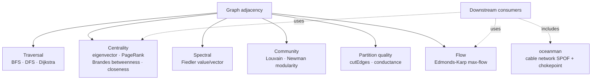

# zig-graph

> Graph primitives in Zig 0.16. 70/70 tests including networkx 3.6.1 cross-validation. Foundational substrate for downstream analysis repos.

[](https://github.com/SMC17/zig-graph/actions)
[](LICENSE)
[](https://ziglang.org/)
[](#tests)
[](#tests)

Proof level: `unit-tested` + `audited` (cross-validated vs networkx 3.6.1; mutation-tested 11/14 killed)

Sparse graph algorithms in pure Zig — traversal, centrality, spectral, community, and max-flow primitives over a 3-field `Graph` type with caller-owned results and no hidden allocation.

`v0.x` release. Pre-1.0 in semver spirit: Zig itself is on 0.16, and the library has no production-deployment soak time. See [`STATUS.md`](STATUS.md) for the per-component proof index and the open gates.

## Architecture



## Downstream consumers

- [`SMC17/oceanman`](https://github.com/SMC17/oceanman) — submarine
  cable knowledge base; uses `zig-graph` for chokepoint + SPOF
  analysis on the global cable network alongside `zig-h3` for
  cable-landing geospatial indexing.

## Operations

Edges are undirected by default; the directed variant is explicit per algorithm. All routines take a `Graph` + `Allocator` and return caller-owned memory; nothing is shared across calls.

| Operation | Complexity | Reference | Proof level |
|---|---|---|---|
| `bfs` / `dfs` | O(\|V\| + \|E\|) | Moore 1959 / Tarjan 1972 | `unit-tested` |
| `sssp` (Dijkstra) | O((\|V\| + \|E\|) log \|V\|) | Dijkstra 1959 | `unit-tested` |
| `bfsPath` | O(\|V\| + \|E\|) | Moore 1959 | `unit-tested` |
| `buildAdjacency` / `buildDirectedAdjacency` | O(\|V\| + \|E\|) | CSR (Tinney & Walker 1967) | `unit-tested` |
| `weightedDegree` | O(\|E\|) | — | `unit-tested` |
| `eigenvectorCentrality` | O(k(\|V\| + \|E\|)) | Bonacich 1972 | `unit-tested` + `audited` (narrow) |
| `pagerank` (undirected) | O(k(\|V\| + \|E\|)) | Page et al. 1999 | `unit-tested` + `audited` |
| `directedPagerank` | O(k(\|V\| + \|E\|)) | Page et al. 1999 | `unit-tested` + `audited` |
| `betweennessCentrality` | O(\|V\|·\|E\|) BFS / O(\|V\|·(\|V\|+\|E\|) log \|V\|) Dijkstra | Brandes 2001 | `unit-tested` + `audited` |
| `closenessCentrality` | O(\|V\|·(\|V\|+\|E\|) log \|V\|) | Wasserman & Faust 1994 | `unit-tested` + `audited` |
| `fiedlerValue` / `fiedlerVector` / `fiedler` | O(k(\|V\| + \|E\|)) | Fiedler 1973 (deflated power iter.) | `unit-tested` |
| `louvain` / `modularity` | O(k·\|E\|) heuristic | Blondel et al. 2008; Newman 2006 | `unit-tested` + `audited` |
| `cutEdges` | O(\|E\|) | — | `unit-tested` |
| `conductance` | O(\|E\|) | Chung 1997 | `unit-tested` |
| `maxFlowEdmondsKarp` | O(\|V\|·\|E\|²) | Edmonds & Karp 1972 | `unit-tested` |

`k` is the iteration cap (default: 32 for eigenvector, 40 for PageRank, 1000 for Fiedler).

The cross-validation suite (`tests/crossval_test.zig`, also wired into `zig build test`) compares output against networkx 3.6.1 + closed-form references on canonical graphs (weighted Zachary karate, Petersen, P_5, C_6, K_5, plus four directed graphs). Observed deltas: PageRank 9.6e-12, eigenvector centrality 1.1e-15, modularity/conductance/cut size exact, Louvain Q 0.444904 matching networkx weighted-louvain best-of-50-seeds.

## Tests

`zig build test` — **70 tests pass on Zig 0.16.0** (51 unit + 19 cross-validation). The cross-val step is wired into the default `test` step, so any future regression against networkx is a CI break.

Line coverage: 86.98% on `src/` (394/453 lines, measured by `tools/coverage.sh` via kcov on a dedicated coverage-driver). `root.zig` 94.20%, `community.zig` 93.55%, `centrality.zig` 81.16%, `traversal.zig` 81.20%, `spectral.zig` 76.74%. Uncovered lines are predominantly defensive `unreachable` branches + `errdefer` cleanup paths.

Mutation harness (`tools/mutation-test.sh`): **11 killed / 3 survived** across 14 operators on `root`/`spectral`/`community`/`centrality`. All three survivors are honestly classified (one real-narrow-tolerance, two equivalent mutants). See [`STATUS.md`](STATUS.md).

## Design choices

- **Edges are undirected by default.** Every algorithm except `directedPagerank`, `buildDirectedAdjacency`, and `maxFlowEdmondsKarp` walks both endpoints symmetrically. For directed semantics, build a directed adjacency yourself or use the directed variants.
- **No node payload in the graph type.** Nodes are bare `usize` IDs in `0..node_count`. Callers keep their own arrays of metadata (labels, coordinates, type tags) indexed by node ID. The library was extracted from a research codebase where the algorithms had to coexist with domain-specific node and edge schemas without forcing them into the library type.
- **Caller-owned result buffers.** Every algorithm takes an allocator and returns a slice (or a small result struct exposing one). Caller owns the result and frees it with `allocator.free` or `.deinit()`. No internal allocation pools, no implicit cleanup, no thread-local cache.

## Install

Add to `build.zig.zon`:

```zig
.dependencies = .{
    .graph = .{
        .url = "https://github.com/SMC17/zig-graph/archive/refs/heads/main.tar.gz",
        .hash = "...",
    },
},
```

In `build.zig`:

```zig
const graph = b.dependency("graph", .{
    .target = target,
    .optimize = optimize,
});
exe.root_module.addImport("graph", graph.module("graph"));
```

Minimum Zig version: `0.16.0`.

## Quickstart

```zig
const std = @import("std");
const graph = @import("graph");

pub fn main() !void {
    var gpa: std.heap.DebugAllocator(.{}) = .init;
    defer _ = gpa.deinit();
    const allocator = gpa.allocator();

    // Two triangles joined by a bridge edge — a textbook two-community graph.
    var g = graph.Graph.init(allocator, 6);
    defer g.deinit();
    try g.addEdge(0, 1, 1.0);
    try g.addEdge(1, 2, 1.0);
    try g.addEdge(0, 2, 1.0);
    try g.addEdge(3, 4, 1.0);
    try g.addEdge(4, 5, 1.0);
    try g.addEdge(3, 5, 1.0);
    try g.addEdge(2, 3, 1.0); // bridge

    const bc = try graph.betweennessCentrality(g, allocator, .{ .unweighted = true });
    defer allocator.free(bc);

    var r = try graph.louvain(g, allocator, .{});
    defer r.deinit();

    var fr = try graph.fiedler(g, allocator, .{});
    defer fr.deinit();

    std.debug.print("communities={d} modularity={d:.4} fiedler={d:.4}\n",
        .{ r.num_communities, r.modularity, fr.value });
    for (bc, 0..) |v, i| std.debug.print(" node {d}: betweenness {d:.2}\n", .{ i, v });
}
```

## API

```zig
pub const Edge = struct { source: usize, target: usize, weight: f64 = 1.0 };

pub const Graph = struct {
    node_count: usize,
    edges: std.ArrayList(Edge),
    allocator: std.mem.Allocator,

    pub fn init(allocator: std.mem.Allocator, node_count: usize) Graph;
    pub fn deinit(self: *Graph) void;
    pub fn addEdge(self: *Graph, source: usize, target: usize, weight: f64) Error!void;
};

// --- degree / spectral / pagerank ---
pub fn weightedDegree(graph: Graph, allocator: std.mem.Allocator) Error![]f64;

pub const EigenvectorOptions = struct { iterations: usize = 32 };
pub fn eigenvectorCentrality(graph: Graph, allocator: std.mem.Allocator, options: EigenvectorOptions) Error![]f64;

pub const PageRankOptions = struct { damping: f64 = 0.85, iterations: usize = 40 };
pub fn pagerank(graph: Graph, allocator: std.mem.Allocator, options: PageRankOptions) Error![]f64;

pub const DirectedPageRankOptions = struct { damping: f64 = 0.85, iterations: usize = 40 };
pub fn directedPagerank(graph: Graph, allocator: std.mem.Allocator, options: DirectedPageRankOptions) Error![]f64;

pub const FiedlerOptions = struct { iterations: usize = 1_000, tolerance: f64 = 1e-10 };
pub const FiedlerResult = struct { value: f64, vector: []f64, iterations: usize, allocator: std.mem.Allocator };
pub fn fiedler(graph: Graph, allocator: std.mem.Allocator, options: FiedlerOptions) Error!FiedlerResult;
pub fn fiedlerValue(graph: Graph, allocator: std.mem.Allocator, options: FiedlerOptions) Error!f64;
pub fn fiedlerVector(graph: Graph, allocator: std.mem.Allocator, options: FiedlerOptions) Error![]f64;

// --- centrality ---
pub const BetweennessOptions = struct { unweighted: bool = false, normalize: bool = false };
pub fn betweennessCentrality(graph: Graph, allocator: std.mem.Allocator, options: BetweennessOptions) Error![]f64;
pub fn closenessCentrality(graph: Graph, allocator: std.mem.Allocator) Error![]f64;

// --- community ---
pub const LouvainOptions = struct {
    max_levels: usize = 32,
    max_sweeps_per_level: usize = 64,
    tolerance: f64 = 1e-7,
};
pub const LouvainResult = struct { labels: []u32, num_communities: usize, modularity: f64, allocator: std.mem.Allocator };
pub fn louvain(graph: Graph, allocator: std.mem.Allocator, options: LouvainOptions) Error!LouvainResult;
pub fn modularity(graph: Graph, partition: []const u32, allocator: std.mem.Allocator) Error!f64;

// --- partition quality ---
pub fn cutEdges(graph: Graph, partition: []const u32) Error!usize;
pub fn conductance(graph: Graph, allocator: std.mem.Allocator, partition: []const u32, set: u32) Error!f64;

// --- traversal ---
pub fn bfs(graph: Graph, start: usize, allocator: std.mem.Allocator) Error![]u32;
pub fn dfs(graph: Graph, start: usize, allocator: std.mem.Allocator) Error![]u32;
pub fn sssp(graph: Graph, start: usize, allocator: std.mem.Allocator) Error![]f64;
pub fn bfsPath(graph: Graph, start: usize, end: usize, allocator: std.mem.Allocator) Error!?[]u32;

// --- flow ---
pub fn maxFlowEdmondsKarp(graph: Graph, source: usize, sink: usize, allocator: std.mem.Allocator) FlowError!f64;

pub const Error = error{
    NodeIndexOutOfRange,
    PartitionSizeMismatch,
} || std.mem.Allocator.Error;
```

## Algorithmic notes

**Eigenvector centrality** (Bonacich 1972) runs power iteration on the weighted adjacency matrix for a fixed number of steps (default 32). Each step computes `x' = A x` and normalizes. For connected non-bipartite graphs the Perron-Frobenius eigenvector dominates and 32 iterations are usually sufficient for f64-precision convergence on graphs up to ~10⁴ nodes.

**Undirected PageRank** (Page et al. 1999) uses the symmetric formulation: each edge contributes `damping * rank(endpoint) * weight / degree(endpoint)` mass to the other endpoint per iteration. Dangling nodes (zero weighted degree) redistribute their rank uniformly. Result sums to ~1.0.

**Directed PageRank** walks edges only in their stated direction. Sinks (zero out-weight) redistribute mass uniformly per iteration to preserve mass conservation. Result sums to ~1.0.

**Betweenness centrality** implements Brandes 2001. Two code paths: BFS for `unweighted = true` (O(|V|·|E|) total), Dijkstra otherwise (O(|V|·(|V|+|E|) log |V|)). The accumulation pass aggregates dependencies in reverse stack order. Output is halved to avoid double-counting undirected shortest paths. With `normalize = true` the result is scaled by `2 / ((n-1)(n-2))` so values lie in `[0, 1]`.

**Closeness centrality** uses Wasserman-Faust normalisation: `((R-1)/(n-1)) · ((R-1)/sum_dist)` where `R` is the reachable component size from `v`. Isolated nodes get 0.

**Fiedler value** (Fiedler 1973) is computed by deflated power iteration on `M = τI − L` where `τ = 2·max_deg + 1` (Gershgorin bound on `λ_max(L)`). The all-ones eigenvector (corresponding to `λ₀ = 0`) is projected out after each step, so the iterate converges to the eigenvector of `M`'s *next* largest eigenvalue — which corresponds to `L`'s smallest non-zero eigenvalue, the Fiedler value. We then return `λ₁` directly via the Rayleigh quotient `xᵀ L x`. Cost per iteration: `O(|V| + |E|)`. No matrix factorisation, no Lanczos basis, no Krylov subspace storage. Convergence rate depends on the spectral gap `|λ₂ − λ₁|`.

Canonical Fiedler values used in tests (unit weights):

| Graph | λ₁ |
|---|---|
| Path P₄ | `2 (1 − cos(π/4))` ≈ 0.5858 |
| Path P₁₀ | `2 (1 − cos(π/10))` ≈ 0.0979 |
| Cycle C₆ | `2 (1 − cos(π/3))` = 1.0 |
| Star K₁,₄ | 1.0 |
| Complete K₄ | 4.0 |
| Barbell (two K₃ + bridge) | ≈ 0.4384 |
| Two disconnected K₂ | 0.0 (within 1e-6) |

**Louvain community detection** (Blondel et al. 2008) alternates local-move and aggregation phases. Local-move sweeps every node and tries each neighbour's community, picking the largest `ΔQ` move. Aggregation collapses each community into a super-node with self-loops carrying the intra-community weight. Halts when a local-move phase produces no improvement. Result includes the final modularity `Q` (Newman 2006).

**Conductance** uses the standard definition `cut(S) / min(vol(S), vol(V\S))` where `vol(X)` is the sum of weighted degrees of nodes in `X`. Returns `0.0` if either side has zero volume (caller can treat this as "undefined").

**Edmonds-Karp max-flow** (Edmonds & Karp 1972) is the BFS-augmenting-path specialisation of Ford-Fulkerson; each iteration finds a shortest augmenting path in the residual graph, yielding O(|V|·|E|²) worst-case time. The implementation models the input as a directed network with capacity `weight` on each edge; for undirected behaviour, the caller adds edges in both directions.

## Out of scope (current)

These are deliberately deferred:

- **Leiden refinement** (Traag et al. 2019). Louvain occasionally creates internally disconnected communities at deep aggregation; Leiden fixes this with a refinement phase.
- **Parallel-edge weighting** at construction time. Right now duplicate edges accumulate as parallel edges. For most algorithms this is semantically correct (the weight sums at the algorithm level); Louvain collapses them in `Aggregated.fromGraph`. If you want explicit parallel-edge merging at the `Graph` level, do it in your own builder.
- **Hypergraphs.** The library is a binary-edge graph. Hyperedges with arity > 2 need a different data model (incidence matrix).
- **ILP-based optimal community detection.** The maximum-modularity partition is NP-hard; we ship the standard heuristic. If you want exact optima for small graphs, wrap a MILP solver.
- **CSR storage at the Graph level.** The current `ArrayList(Edge)` representation costs us a one-time `O(|V| + |E|)` adjacency build per traversal/centrality call. For graphs into the millions of edges the amortisation matters; the right upgrade path is a `compileAdjacency()` method on `Graph` that caches the CSR. We have not yet hit a use case where this is binding.
- **GPU offload.** This is intentionally a pure-Zig host-side library. GPU work belongs in a separate sibling crate.
- **Faster max-flow.** Edmonds-Karp is the simplest BFS-augmenting-path algorithm. Dinic's algorithm (O(V²·E)) and push-relabel (O(V²·√E)) are follow-ups when a workload requires them.
- **Min-cut / min s-t cut.** Trivially derivable from max-flow once the residual graph is exposed; not yet a separate public API.
- **A\* search.** Heuristic-guided shortest path. Useful for spatial graphs; not yet shipped.
- **Strongly-connected components** (Tarjan 1972 / Kosaraju). Useful for directed graphs; not yet shipped.

## Benchmarks

```sh
zig build bench
```

Six benchmarks ship under `bench/`:

- `bench_pagerank.zig` — undirected PageRank on random sparse graphs at 100 / 1 000 / 10 000 nodes (avg degree ~8).
- `bench_centrality.zig` — eigenvector centrality on the same shapes.
- `bench_construct.zig` — `Graph.init` + N `addEdge` calls at 1 K / 10 K / 100 K edges.
- `bench_betweenness.zig` — Brandes' algorithm (BFS variant) at 100 / 1 000 nodes. (10 K skipped — Brandes is O(VE) and a 10 K-node sparse graph takes minutes.)
- `bench_louvain.zig` — full Louvain pass at 100 / 1 000 nodes. Reports the final modularity Q + community count alongside timing.
- `bench_fiedler.zig` — deflated power iteration at 100 / 1 000 / 10 000 nodes. Reports the converged Fiedler value + iteration count alongside timing.

A seventh **scale benchmark** lives behind a separate `zig build bench-scale` step (kept off the regular `bench` umbrella because the 1M-node graph takes ~30 s and ~320 MB peak RSS):

- `bench_scale.zig` — 100K-node and 1M-node Erdős–Rényi graphs (avg degree ~20) running `pagerank`, `directedPagerank`, `bfs`, `sssp` (Dijkstra), and `weightedDegree`, each with its algorithm-level invariant asserted at scale. The process exits non-zero if any invariant breaks — the bench doubles as a scale-correctness regression test. **Pinned-hardware numbers** in [`bench/RESULTS.md`](bench/RESULTS.md): PageRank on 1M nodes / 10M edges in 27 s, sum-to-1 invariant delta 2.7e-14 (Intel Core i7-1065G7 @ 1.30 GHz, Linux, Zig 0.16, laptop with concurrent agents).

Output is parseable `key=value` whitespace-separated lines so external collectors can scrape them.

Representative numbers on the maintainer's workstation (Intel Core i7-1065G7 @ 1.30 GHz, Linux 7.0.3-arch1-1 x86_64, Zig 0.16.0, `zig build bench -Doptimize=ReleaseFast`, run on a busy laptop running concurrent agents):

| Bench | Size | ms/run | ops/sec | notes |
|---|---|---:|---:|---|
| pagerank | 100 nodes | 0.11 | 8 868 | 40 iters |
| pagerank | 1 000 nodes | 1.27 | 784 | 40 iters |
| pagerank | 10 000 nodes | 17.4 | 57 | 40 iters |
| centrality | 100 nodes | 0.22 | 4 487 | 32 power iters |
| centrality | 1 000 nodes | 1.36 | 736 | 32 power iters |
| centrality | 10 000 nodes | 25.97 | 38 | 32 power iters |
| betweenness | 100 nodes | 1.98 | 505 | Brandes BFS, O(VE) |
| betweenness | 1 000 nodes | 182.18 | 5 | Brandes BFS, O(VE) |
| louvain | 100 nodes | 0.91 | 1 098 | Q ≈ 0.319, 6 communities |
| louvain | 1 000 nodes | 9.46 | 105 | Q ≈ 0.330, 16 communities |
| fiedler | 100 nodes | 2.92 | 342 | 574 iters, λ₁ ≈ 0.7955 |
| fiedler | 1 000 nodes | 65.19 | 15 | hit iter cap on disconnected ER graph |
| fiedler | 10 000 nodes | 479 | 2 | disconnected components → λ₁ ≈ 0 (correct) |
| construct | 1 K edges | 0.17 | 11.4 M edges/s | 87 ns/edge |
| construct | 10 K edges | 1.19 | 8.4 M edges/s | 119 ns/edge |
| construct | 100 K edges | 10.31 | 9.7 M edges/s | 103 ns/edge |

These numbers are on a busy laptop running concurrent agents; run-to-run variance is ±2× for the inner-loop benchmarks. Fiedler runs on disconnected Erdős–Rényi random graphs converge to ≈ 0 — that is correct (a graph with `k` components has `k` zero eigenvalues), not a bug.

## Honest Type-I / Type-II accounting

Things this README could be read to over-claim (Type-I risk):

- "Validated against closed-form λ₁" applies to the **values** the algorithm returns on tiny canonical graphs (paths, cycles, stars, cliques, barbells), not to the full Fiedler-vector decomposition. On pathological inputs (very tight spectral gap, near-degenerate eigenvalues, or disconnected components with `k > 2`) deflated power iteration is known to converge slowly and can return a vector that mixes the bottom-`k` eigenspace. For research-grade spectral work on big graphs you want Lanczos / LOBPCG; that is out of scope here.
- Louvain is a **heuristic**. The library's modularity result is the modularity of the local-optimum partition Louvain finds, not the global maximum (NP-hard in general). On graphs with very tight cluster separation Louvain occasionally produces internally-disconnected communities at deep aggregation; that is a known Louvain artefact and the "Out of scope" section names Leiden refinement as the follow-up.
- The benchmark numbers come from a single laptop run while many other agents were active. Treat the table as the *shape* of the cost curve, not as a steady-state production figure.
- Edmonds-Karp max-flow is the simplest BFS-augmenting-path variant; on dense / high-capacity workloads, modern push-relabel or Dinic implementations are orders of magnitude faster. The current implementation is correctness-first.

Things this README could be read to under-claim (Type-II risk):

- The cross-validation suite (`tests/crossval_test.zig`) runs on every `zig build test`, so any future regression that diverges from networkx 3.6.1 on the canonical karate / Petersen / directed-binary-tree references breaks CI loudly. The fuzz harnesses similarly catch NaN escapes from PageRank, negative betweenness, and Louvain modularity outside `[-0.5, 1]`.
- The PageRank dangling-node path is exercised by a dedicated unit test that asserts an isolated node receives positive mass and the total still sums to `1.0 ± 1e-6` — meaning the library does *not* silently leak mass on graphs with sinks, which is the most common PageRank implementation bug.
- No internal allocator. Every result is caller-owned and freed with `allocator.free` or `.deinit()`. There is no global state and no thread-local cache, so the library is safe to use from multiple threads as long as each thread holds its own `Graph` and `Allocator`.

## License

AGPL-3.0. See [`LICENSE`](LICENSE).
